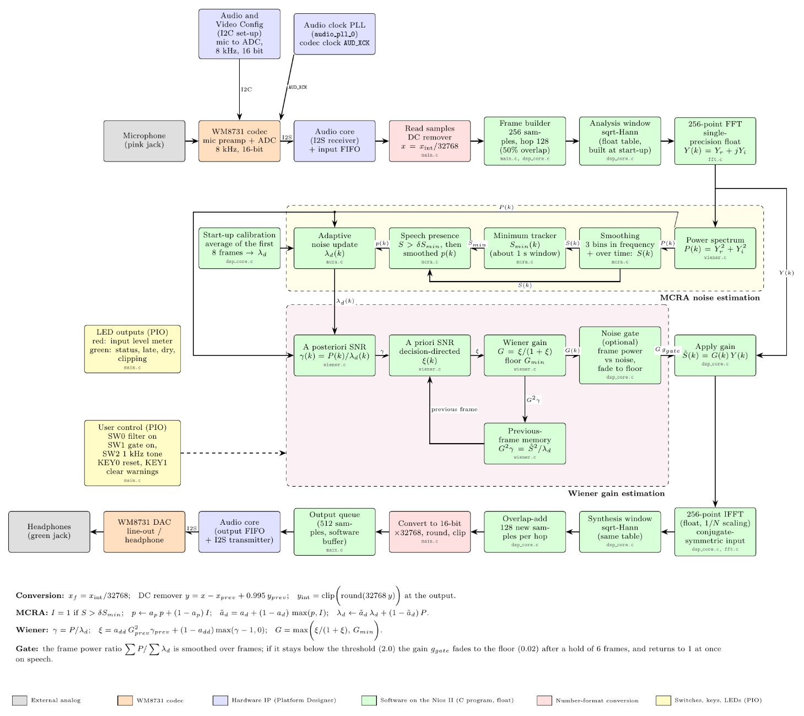

<div align="center">

# 🎙️ Real-Time Speech Denoiser on FPGA

**Wiener gain filtering with MCRA noise estimation, running live on a Nios II soft processor**


[Overview](#overview) •
[Signal chain](#signal-chain) •
[Quick start](#quick-start) •
[Build from source](#build-from-source) •
[Board controls](#board-controls) •
[Folder guide](#folder-guide) •
[Authors](#authors)

</div>

---

## Overview

Background noise from fans, air conditioners and crowds makes speech harder to understand. This project removes it **as you speak**: a microphone feeds the DE2-115's WM8731 codec, a Nios II processor cleans the audio frame by frame in the frequency domain, and the result plays on headphones about 32 ms later.

The noise level is not fixed in advance. **MCRA** (Minima Controlled Recursive Averaging) follows it continuously, so the filter adapts when the noise changes. A **Wiener gain** with a decision-directed SNR estimate then turns each frequency bin down according to how much noise it holds.

### Key figures

| | |
|---|---|
| 🎚️ Sampling | 8 kHz, 16-bit, mono |
| 🪟 Framing | 256-sample frames, 128-sample hop (50 % overlap), √Hann window |
| 📊 Spectrum | 256-point radix-2 FFT → 129 bins, 31.25 Hz apart |
| ⏱️ Real-time budget | 16 ms per block · 62.5 blocks/s |
| 🔇 Max suppression | 16.5 dB per bin (gain floor 0.15) · ≈50 dB in pauses with the gate on |
| 🔁 Noise tracking | adapts within ≈1 s · initial calibration 128 ms |
| ⌛ Delay | ≈32 ms input to output |
| 💾 Memory | ≈86 KB of 128 KB on-chip RAM, no external memory |

---

## Signal chain



**Per block of 128 new samples:**

1. **DC blocker** — removes the codec's DC offset: $y[n] = x[n] - x[n-1] + 0.995\,y[n-1]$
2. **Analysis** — slide the 256-sample buffer, multiply by √Hann, 256-point FFT, power spectrum $P_k = |X_k|^2$
3. **MCRA noise estimate** $\lambda_k$
   - smooth over frequency (¼ ½ ¼) and time: $S_k \leftarrow 0.8\,S_k + 0.2\,S_{f,k}$
   - track the minimum $S_{\min,k}$ over a 64-frame window
   - speech present if $S_k > 5\,S_{\min,k}$; presence probability $p_k \leftarrow 0.2\,p_k + 0.8\,I_k$
   - update $\lambda_k \leftarrow \tilde\alpha_k\,\lambda_k + (1-\tilde\alpha_k)\,P_k$ with $\tilde\alpha_k = 0.95 + 0.05\,\max(p_k, I_k)$ — a bin flagged as speech freezes its noise estimate
4. **Wiener gain**
   - a posteriori SNR $\gamma_k = P_k / \lambda_k$
   - a priori SNR $\xi_k = 0.98\,G_{k,\text{prev}}^2\,\gamma_{k,\text{prev}} + 0.02\,\max(\gamma_k - 1, 0)$
   - gain $G_k = \max\!\left(\dfrac{\xi_k}{1+\xi_k},\ 0.15\right)$
5. **Noise gate (optional)** — fades noise-only frames down by a further 34 dB, opens instantly on speech
6. **Synthesis** — apply $G_k$, rebuild the conjugate-symmetric half, IFFT, √Hann window, overlap-add

All constants live in [`firmware/params.h`](firmware/params.h).

---

## Quick start

Run the pre-built program without compiling anything.

**You need:** DE2-115 board · microphone (pink jack) · headphones (green jack) · Quartus Prime 18.1 Lite with Nios II EDS · USB-Blaster driver

```bash
# 1. Load the FPGA design (Quartus Programmer, or from the Nios II Command Shell):
nios2-configure-sof fpga/output_files/<project>.sof

# 2. Load and start the program:
nios2-download -g prebuilt/dsp_core.elf

# 3. (optional) watch the console:
nios2-terminal
```

You should see `Noise suppressor start`. Flip **SW0** up in a quiet moment, wait for **LEDG2** to go out, then speak.

> The `.sof` belongs in `fpga/output_files/` — see [`fpga/README.md`](fpga/README.md).

---

## Build from source

<details>
<summary><b>1 · FPGA design</b></summary>

1. Open `fpga/<project>.qpf` in Quartus Prime 18.1.
2. Open `fpga/<system>.qsys` in Platform Designer → **Generate HDL**.
3. **Processing ▸ Start Compilation**.
4. Program the new `.sof` (**Tools ▸ Programmer**, USB-Blaster, JTAG). Keep SW19 on RUN.

The Platform Designer system is shown in [`docs/figures/platform_designer.png`](docs/figures/platform_designer.png).
The firmware expects these component names: `audio_0`, `switches`, `keys`, `ledr`, `ledg`.

</details>

<details>
<summary><b>2 · Board support package</b></summary>

From the **Nios II Command Shell**, in the repository root:

```bash
nios2-bsp hal bsp fpga/<system>.sopcinfo
```

This creates `bsp/` next to `firmware/`, which is where the Makefile looks for it.

</details>

<details>
<summary><b>3 · Firmware</b></summary>

```bash
cd firmware
make
nios2-download -g dsp_core.elf
nios2-terminal
```

Built with `-O2`. Float maths uses the **Floating Point Hardware 2** custom instructions, so keep every constant single-precision (`0.5f`, not `0.5`).

</details>

---

## Board controls

<table>
<tr><th>Switch / key</th><th>Action</th><th>LED</th><th>Meaning</th></tr>
<tr><td><b>SW0</b></td><td>Noise reduction on (starts noise learning)</td><td>LEDR 0–17</td><td>Input level, 3 dB per step</td></tr>
<tr><td><b>SW1</b></td><td>Noise gate on</td><td>LEDG0</td><td>Block missed its 16 ms deadline</td></tr>
<tr><td><b>SW2</b></td><td>1 kHz test tone on the output</td><td>LEDG1</td><td>Output ran dry</td></tr>
<tr><td><b>KEY0</b></td><td>Learn the noise again (stay quiet ≈1 s)</td><td>LEDG2</td><td>Learning noise</td></tr>
<tr><td><b>KEY1</b></td><td>Clear warning LEDs</td><td>LEDG3 / LEDG4</td><td>Reduction on / gate on</td></tr>
<tr><td></td><td></td><td>LEDG7</td><td>Input clipping</td></tr>
</table>

**Demo in four moves:** speak with SW0 down (noisy) → SW0 up while it is quiet → speak again (clean) → SW1 up to silence the pauses.

---

## Folder guide

```
├── firmware/          Nios II application (C) + generated Makefile
│   ├── main.c           codec FIFOs, switches, keys, LEDs — the real-time loop
│   ├── dsp_core.c/.h    framing → FFT → MCRA → Wiener → gate → IFFT → overlap-add
│   ├── fft.c/.h         256-point radix-2 FFT / IFFT
│   ├── mcra.c/.h        MCRA noise estimator (five testable stages)
│   ├── wiener.c/.h      power spectrum + decision-directed Wiener gain
│   ├── params.h         every tunable constant
│   └── dsp_common.h     sample conversions used by PC tests
├── prebuilt/
│   └── dsp_core.elf     ready-to-run firmware
├── fpga/              Quartus project and .sof (see fpga/README.md)
└── docs/
    ├── report.pdf       full project report
    └── figures/         signal chain, Platform Designer system
```

The DSP files contain no board-specific code, so the same sources compile on a PC for testing.

---

## Tuning cheatsheet

| Want… | Change in `params.h` |
|---|---|
| More suppression | lower `G_MIN` (watch for musical noise) |
| Smoother, less "watery" sound | raise `A_DD` towards 0.99 |
| Faster reaction to new noise | lower `MCRA_L` |
| Speech less likely mistaken for noise | lower `DELTA` |
| Quieter pauses with the gate | lower `GATE_FLOOR` |

---

## Troubleshooting

- **Silence** — check the jacks (mic pink, headphones green); SW2 should give a clear tone.
- **`no Nios II processors`** — the `.sof` is not loaded; reprogram and keep SW19 on RUN.
- **`*_BASE undeclared`** — a Platform Designer component name differs from those listed above.
- **LEDG0 / LEDG1 lighting** — the build is too slow: check `-O2`, the FPU, and a Nios II/f core.
- **Muffled speech** — press KEY0 in a quiet moment, or raise `G_MIN`.

---

## Authors

**S. Prajwal** · R. Arun Kumar · P. Hari Krishna
M.Tech VLSI Design, VIT Vellore — *Digital System Design using FPGA*, Fall 2026-27

### References
- I. Cohen, B. Berdugo — *Noise estimation by minima controlled recursive averaging for robust speech enhancement*, IEEE SPL, 2002
- Y. Ephraim, D. Malah — *Speech enhancement using a minimum mean-square error short-time spectral amplitude estimator*, IEEE TASSP, 1984
- Terasic — *DE2-115 User Manual*; Intel FPGA University Program — *Audio* and *Audio/Video Configuration* cores
